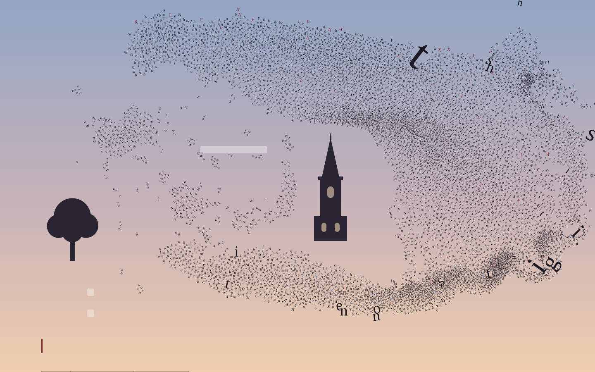
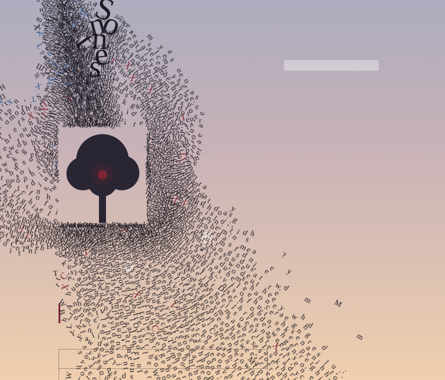
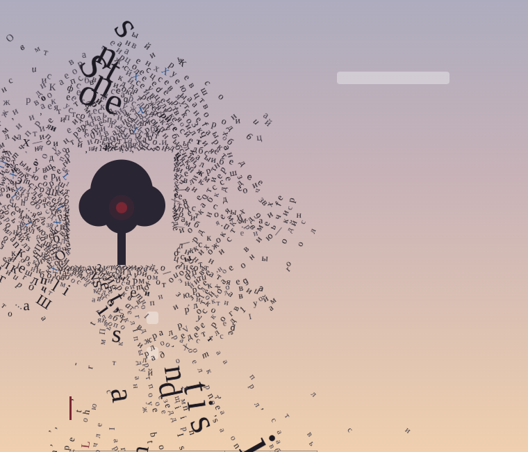
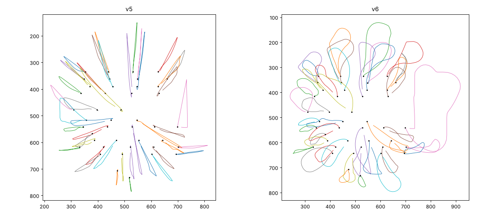

# Мурмурация букв

[English](README.md) · **Русский**

Каждая буква веб-страницы становится существом с телом и массой — и улетает стаей, как скворцы.



**▶ [Живое демо](https://2d0x.github.io/letter-murmuration/dist/v6/)** · **🔖 [Поставить закладку](https://2d0x.github.io/letter-murmuration/dist/bm/)** · [Все версии](https://2d0x.github.io/letter-murmuration/)

Три режима:

- **Мурмурация** — буквы летают стаей, как скворцы.
- **Орда** — буквы бегут к курсору, как толпа зомби.
- **Покой** — буквы стоят на местах. Если провести курсором, вспархивают и садятся обратно.

Исходный вопрос: можно ли поведением стаи из исследований скворцов заменить «прямолинейных» мобов в играх вроде Vampire Survivors и при этом держать тысячи существ? Ответ: да, десятки тысяч в одном потоке JS.

- 7,7 тыс. букв: стая около 10 мс на шаг.
- 26 тыс. букв (×4 текста): стая 30 мс, орда 34 мс на шаг.

Замеры в headless Chromium (программный WebGL, 1440×900). На обычном компьютере с видеокартой кадров больше.

## Попробовать за 10 секунд

1. **Закладка.** Откройте [страницу установки](https://2d0x.github.io/letter-murmuration/dist/bm/) и перетащите кнопку «Мурмурация» на панель закладок. Нажмите её на любом сайте. Скрипт целиком внутри закладки, около 57 КБ. Повторное нажатие или `Esc` выключает.
2. **Демо-страница.** Откройте [демо](https://2d0x.github.io/letter-murmuration/dist/v6/): двенадцать сонетов Шекспира с картинками, списками, таблицей и шкалой кеглей.
3. **Консоль.** Скопируйте [`dist/v6/letters-swarm-console-v6.js`](dist/v6/letters-swarm-console-v6.js) и вставьте в консоль DevTools на любой странице.

## Клавиши и настройки

| Клавиша | Действие |
|---|---|
| `1` | Покой |
| `2` | Мурмурация |
| `3` | Орда |
| `V` | Тела с объёмом или «призраки» |
| `H` | Сокол-охотник |
| `F` | Точкомёт |
| `Esc` | Выключить (в закладке и консольной версии) |

Панель **«Настройки динамики»**: базовая скорость орды, обзор зомби, скорость птиц, испуг от курсора, число соседей K, скорость волны взлёта, реакция зомби, отступ птиц от картинок, скорострельность, скорость пуль.

## Как это работает

- **Восприятие.** Каждая буква видит K = 7 ближайших соседей — топологическое правило из наблюдений за скворцами ([Ballerini et al., PNAS 2008](https://doi.org/10.1073/pnas.0711437105)). Соседи ищутся по равномерной сетке с сортировкой подсчётом. Восприятие обновляется через шаг, по очереди; птицы в панике обновляют его каждый шаг.
- **Правила стаи.** Расталкивание, выравнивание и сближение по [Рейнольдсу (1987)](https://doi.org/10.1145/37402.37406). Плюс птицы заранее уклоняются от столкновения по времени до него ([Karamouzas, Skinner, Guy, PRL 2014](https://doi.org/10.1103/PhysRevLett.113.238701)).
- **Тела.** Буквы — круги с массой по площади глифа; у жирного начертания масса выше. Столкновения разрешаются позиционно, методом Гаусса — Зейделя, как в position-based dynamics для толп ([Weiss et al. 2017](https://doi.org/10.1145/3136457.3136462)).
- **Полёт.** Скорость почти постоянная, поворот ограничен (крен). Стая держится над «гнездовьем» в верхней части экрана — идея модели StarDisplay Хемелрейк и Хильденбрандта ([Hildenbrandt, Carere, Hemelrijk 2010](https://doi.org/10.1093/beheco/arq149)). Развороты начинают несколько зачинщиков, и волна бежит по стае ([Attanasi et al. 2014](https://doi.org/10.1038/nphys3035)).
- **Хищники.**
  - Сокол-охотник атакует сам; тип ответа стаи зависит от скорости атаки ([Storms et al. 2019](https://doi.org/10.1007/s00265-018-2609-0)).
  - Курсор — второй сокол. Птица просчитывает путь курсора на 12 шагов вперёд и уходит с него вбок. Тревога передаётся соседям волной.
- **Орда.**
  - Каждый идёт за соседом впереди: не быстрее него, с запасом по зазору, как в моделях транспортного потока.
  - Если упёрся, обходит сбоку. Сторону выбирает сам, по карте плотности толпы вокруг героя.
  - У каждого своё время реакции; героя видит с запаздыванием.
  - Крупные буквы видят дальше, но медленнее.
- **Картинки — препятствия.** Птицы облетают их по лучу вперёд (Reynolds 1999, *Steering Behaviors for Autonomous Characters*), орда обтекает.
- **Рендер.** Все буквы рисуются одним вызовом WebGL2 (instanced quads + атлас глифов); если WebGL2 нет — Canvas2D. Оригинальный текст становится прозрачным, но остаётся в DOM для доступности и поиска.

## История версий

Каждая версия — отдельная папка `vN/` и сборка `dist/vN/`.

| Версия | Что появилось | Замеры |
|---|---|---|
| [v1](https://2d0x.github.io/letter-murmuration/dist/v1/) | Буквы → боиды, режимы Покой / Мурмурация / Орда, 4 алгоритма поиска соседей для сравнения, WebGL2-рендер | Canvas2D около 100 мс на кадр → WebGL2 |
| [v2](https://2d0x.github.io/letter-murmuration/dist/v2/) | Тела с объёмом и массой, честные K ближайших (вместо «первых найденных»), страх столкновения | Исчезли «стоячие волны» — плотные чёрные скопления |
| [v3](https://2d0x.github.io/letter-murmuration/dist/v3/) | Орда следует за передним и обходит сбоку (ушли «барханы-полумесяцы»), сокол-охотник, гнездовье, точкомёт | — |
| [v4](https://2d0x.github.io/letter-murmuration/dist/v4/) | Взлёт волной от курсора, панель настроек, обзор зомби, птицы предугадывают путь курсора, тестовая страница со ссылками, списками, таблицей, картинками | Рядом с быстрым курсором ближе 25 px: 24,2 → 1,9 птицы |
| [v5](https://2d0x.github.io/letter-murmuration/dist/v5/) | Орда без «линии» и синхронной тряски (убрана общая ось обхода), личное время реакции, птицы облетают картинки, буквы-великаны в 2× и 4× заголовка | Синхронное смещение кольца при скорости 8: 66,8 → 1,8 (частота 2,5 Гц исчезла); птиц у края картинок: 125 → 1,6 |
| [v6](https://2d0x.github.io/letter-murmuration/dist/v6/) | Закладка на всю страницу (закреплённые шапки остаются текстом), при прокрутке просыпаются новые буквы, посадка по дуге, настройки скорострельности и скорости пуль | За 10 с сбито: 101 → 1683 при 240 выстрелах в секунду |

## До и после

**Орда, v4 → v5.** В v4 зомби выстраивались в «линию» и тряслись синхронно; в v5 убрана общая ось обхода.

| v4 | v5 |
|---|---|
|  |  |

**Посадка, v5 → v6.** Траектории букв при возвращении на место: в v5 по прямой, в v6 по дуге.



## Сборка и тесты

```bash
python3 build.py v6                  # → dist/v6/index.html и консольный скрипт
npm install && npm run bookmarklet   # → dist/bm/ (страница установки и bookmarklet.txt)
```

Устройство исходников: `vN/engine.js` — движок, `vN/page.html` — шаблон демо-страницы, `vN/patch.py` — как версия получена из предыдущей. `bm/install.html` — шаблон страницы закладки.

Тесты — Python + Playwright, запускаются из корня:

```bash
pip install playwright && playwright install chromium
python3 tests/test_bm.py
```

`tests/mock_wiki.html` — макет страницы в духе Википедии с собственным текстом.

## Ограничения

- На сайтах со строгой Content Security Policy (Google, YouTube, GitHub) закладка может не сработать.
- На телефоне закладками пользоваться неудобно; демо-страница на телефоне работает, но медленнее.
- Орда не прокладывает маршрут вокруг больших препятствий, только обтекает локально (для этого нужен flow field).

## Благодарности и литература

- Ballerini M. et al. (2008). Interaction ruling animal collective behavior depends on topological rather than metric distance: Evidence from a field study. *PNAS*. [doi:10.1073/pnas.0711437105](https://doi.org/10.1073/pnas.0711437105)
- Reynolds C. W. (1987). Flocks, herds and schools: A distributed behavioral model. *ACM SIGGRAPH Computer Graphics*. [doi:10.1145/37402.37406](https://doi.org/10.1145/37402.37406)
- Reynolds C. W. (1999). Steering Behaviors for Autonomous Characters. Game Developers Conference.
- Karamouzas I., Skinner B., Guy S. J. (2014). Universal Power Law Governing Pedestrian Interactions. *Physical Review Letters*. [doi:10.1103/PhysRevLett.113.238701](https://doi.org/10.1103/PhysRevLett.113.238701)
- Weiss T. et al. (2017). Position-based multi-agent dynamics for real-time crowd simulation. *Motion in Games (MIG '17)*. [doi:10.1145/3136457.3136462](https://doi.org/10.1145/3136457.3136462)
- Hildenbrandt H., Carere C., Hemelrijk C. K. (2010). Self-organized aerial displays of thousands of starlings: a model. *Behavioral Ecology*. [doi:10.1093/beheco/arq149](https://doi.org/10.1093/beheco/arq149)
- Attanasi A. et al. (2014). Information transfer and behavioural inertia in starling flocks. *Nature Physics*. [doi:10.1038/nphys3035](https://doi.org/10.1038/nphys3035)
- Storms R. F. et al. (2019). Complex patterns of collective escape in starling flocks under predation. *Behavioral Ecology and Sociobiology*. [doi:10.1007/s00265-018-2609-0](https://doi.org/10.1007/s00265-018-2609-0)

Шрифты демо-страниц: Cormorant SC, EB Garamond, IBM Plex (Google Fonts). Текст демо — сонеты Шекспира — общественное достояние.

## Лицензия

[MIT](LICENSE) © 2026 Mikhail Yazev
